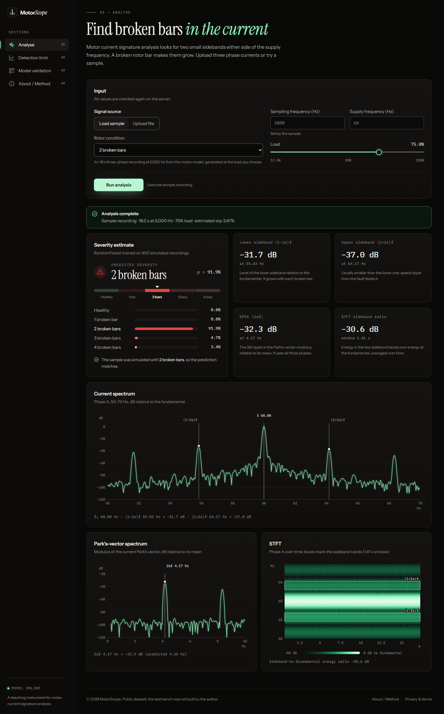

# MotorScope

**Predictive maintenance of induction motors via motor current signature analysis (MCSA).**

MotorScope finds broken rotor bars by listening to a motor's stator current. Each broken bar adds two small sidebands either side of the supply frequency, and the app measures them, combines them with Park's-vector and STFT features, and estimates fault severity with a RandomForest. It also shows honestly where the method stops working: at light load.

**Live demo: [motorscope.vercel.app](https://motorscope.vercel.app)**

Repository: [github.com/ayushmanjha52/predictive-maintenance-of-induction-motor-via-motor-current-signature-analysis](https://github.com/ayushmanjha52/predictive-maintenance-of-induction-motor-via-motor-current-signature-analysis)



## What it does

- **Analyse:** upload a three-phase current recording (`.mat` or `.csv`) or load a sample. The app shows:
  - the zoomed current spectrum with markers at f, (1 − 2s)f and (1 + 2s)f
  - the Park's-vector spectrum with its 2sf component
  - an STFT heatmap with the sideband bands outlined
  - four feature readouts
  - a severity gauge with class probabilities (healthy, or 1–4 broken bars)
  - a warning below 30% load, where the sidebands sit within 1 Hz of the fundamental
- **Detection limit:** sideband level against load for each severity, showing the healthy and faulty curves converging at light load.
- **Model validation:** leave-one-load-out accuracy for each held-out load, plus a majority-class baseline and the pooled confusion matrix. Everything is computed when the server starts; no number is hard-coded.
- **About / Method:** a plain-language explanation of the physics, and the dataset citation.

> **Data.** The model is trained and validated on recordings from a **physics-based simulator** of the motor in the public database by Treml et al. (2020), cited below. It follows the same design: 5 rotor conditions × 8 loads × 10 runs. The measured database needs an IEEE DataPort login, so it isn't bundled. The pipeline reads it directly, and loading it retrains every result. Until then, the site describes its results as coming from simulated recordings and the API reports `data_source: "synthetic"`. Accuracy on simulated data shows that the method works end to end; it isn't a claim about real motors. See [Using the real dataset](#using-the-real-dataset).

## Stack

| Part | Built with |
|---|---|
| Signal processing | NumPy and SciPy: polyphase decimation, Blackman-Harris FFTs, STFT, Park's transform |
| Model | scikit-learn RandomForest with leave-one-load-out validation |
| API | FastAPI and Uvicorn |
| Frontend | React 19, TypeScript, Vite 7, Tailwind CSS 4, Recharts 3, Framer Motion |
| Type | Instrument Serif and Instrument Sans for text, IBM Plex Mono for data |

## Run it locally

You need Node.js 20.19+ (or 22.12+) and Python 3.10+.

```bash
npm install          # root dev tool
npm run setup        # Python venv + packages, frontend packages, demo features if none exist
npm run dev          # API on :8000 and the site on http://localhost:5173
```

Open **http://localhost:5173**, keep **Load sample** selected and press **Run analysis**.

- `npm run setup` picks the first Python that has `venv` and `pip` available: `py -3.12`, then `py -3.11`, then `py -3` on Windows, or `python3` elsewhere.
- Editing a backend file restarts only the API. The reload lives in `scripts/run-api.mjs` rather than `uvicorn --reload`, because on Windows uvicorn's reloader sends a console-wide Ctrl+C that also stops Vite.

### Trying an upload

`samples/sample_3-broken-bars_87.5pct-load_fs5000.csv` is a simulated recording with three broken bars at 87.5% load. Choose **Upload file**, set the sampling frequency to **5000** and the load to **87.5%**. To generate others, run `python synthetic.py out.csv --severity 2 --load 50` from `backend/`.

Accepted formats:

- **CSV:** three current columns named like `ia, ib, ic`, `Ia (A)` or `current_a`, or three or four unnamed columns. An optional time column is used to check the sampling rate you entered.
- **MATLAB v5/v7 `.mat`:** variables such as `Ia/Ib/Ic`, or an N×3 matrix. An `fs` variable, if present, is checked against the rate you entered.
- **MATLAB v7.3 (HDF5):** rejected, with instructions to re-save the file.

## Deploy

### Vercel (the live demo)

[motorscope.vercel.app](https://motorscope.vercel.app) runs on Vercel. The built site is served from Vercel's CDN, and the FastAPI backend runs unchanged as a Python function:

- `vercel.json` sets the build, routing, security headers and asset caching.
- `api/index.py` mounts the app under `/api`.
- Python dependencies come from the root `requirements.txt`.

To deploy your own copy:

```bash
npm i -g vercel
vercel link
vercel deploy --prod
```

Things to know on Vercel:

- **Upload size:** limited to 4 MB, because Vercel caps a function's request body at 4.5 MB. The sample CSV is 3 MB.
- **Cold starts:** the first request after an idle period takes a few seconds while the model trains.
- **Rate limiting** uses the client IP that Vercel's proxy reports.

### Docker

The repository also builds into **one Docker container**: FastAPI serves the built site at `/` and the API under `/api`. No separate frontend host is needed, there are no secrets to configure, and there's no upload limit beyond `MAX_UPLOAD_MB`.

### Hugging Face Spaces

1. Create a new Space at [huggingface.co/new-space](https://huggingface.co/new-space) and choose **Docker → Blank**.
2. Push this repository to the Space. Hugging Face reads its settings from a short header at the top of the Space's `README.md`, so add the header on a deploy branch:

   ```bash
   git remote add space https://huggingface.co/spaces/<your-username>/<space-name>
   git checkout -b space-deploy
   printf -- '---\ntitle: MotorScope\nsdk: docker\napp_port: 7860\n---\n\n' | cat - README.md > README.tmp && mv README.tmp README.md
   git commit -am "Add Space configuration"
   git push --force space space-deploy:main
   git checkout main
   ```

3. The Space builds the image and serves the app at `https://<your-username>-<space-name>.hf.space`.

The image defaults to settings that work on Spaces: `ALLOWED_HOSTS` includes `*.hf.space`, and `FRAME_ANCESTORS` allows the huggingface.co page to embed the app. If Hugging Face rejects the push because of the screenshots, track images with Git LFS (`git lfs track "*.png" "*.jpg"`) before committing.

### Google Cloud Run, or any Docker host

```bash
# Cloud Run builds the Dockerfile for you
gcloud run deploy motorscope --source . --port 7860 --allow-unauthenticated \
  --set-env-vars "ALLOWED_HOSTS=*.run.app,FRAME_ANCESTORS='none'"

# anywhere else
docker build --build-arg SITE_URL=https://your.domain -t motorscope .
docker run -p 7860:7860 -e ALLOWED_HOSTS=your.domain -e "FRAME_ANCESTORS='none'" motorscope
```

### Configuration

| Variable | Default (container) | Purpose |
|---|---|---|
| `ALLOWED_HOSTS` | `localhost,127.0.0.1,*.hf.space` | Host headers the server answers to |
| `FRAME_ANCESTORS` | `'self' https://huggingface.co` | Who may embed the site in a frame |
| `SITE_URL` (build arg) | `http://localhost:7860` | Canonical and Open Graph URLs, `sitemap.xml`, `robots.txt` |
| `MAX_UPLOAD_MB` | `50` | Upload size limit |
| `RATE_LIMIT_PER_MIN` | `20` | Analyses per client per minute |
| `ENABLE_HSTS` | `false` | Set to `true` once the site is served over HTTPS |

The platforms above terminate HTTPS for you. The container runs as a non-root user with `--proxy-headers`, so rate limiting sees real client addresses.

## Using the real dataset

A. E. Treml, R. A. Flauzino, M. Suetake, N. A. R. Maciejewski, *"Experimental database for detecting and diagnosing rotor broken bar in a three-phase induction motor,"* IEEE Dataport, 16 September 2020. doi:[10.21227/fmnm-bn95](https://doi.org/10.21227/fmnm-bn95).

**Public dataset; the test bench was not built by the author.**

The rig is a 1 hp, 4-pole, 60 Hz motor with a 34-bar rotor. It was tested with a healthy rotor and with 1–4 broken bars, at eight loads from 12.5% to 100%, with ten repetitions of each condition.

1. Download the archive (about 6.7 GB) from IEEE DataPort into `backend/data/raw/`. That folder is gitignored.
2. List the recordings in `backend/manifest.csv`, one row each:

   ```csv
   path,severity,load_pct,fs,f_supply,ia_key,ib_key,ic_key
   data/raw/r1b/torque05_exp01.mat,1,62.5,50000,60,,,
   ```

   - `severity` is 0 for healthy, or 1–4 broken bars.
   - `ia_key`, `ib_key` and `ic_key` are optional dotted paths to the currents inside a `.mat` struct, such as `rec.Ia`. Leave them empty to find variables by name.

3. Run `python build_features.py --manifest manifest.csv` from `backend/`. This writes `data/features.csv`.
4. Restart the server. `features.csv` takes precedence over the simulated file, and the site switches to describing its results as measured.

The archive's internal layout isn't documented publicly, so the manifest is deliberately generic rather than tied to particular file names. Check the sampling rate against the dataset's own readme: published figures range from 50 kHz to about 55.6 kHz. A wrong value is caught by the server's sampling-rate check.

Any `features.csv` with the columns `severity, load_pct, lsb_db, usb_db, epva_db, stft_ratio_db` also works.

## Method

- **Decimation:** signals are decimated to about 2 kHz with a Kaiser anti-alias filter (about 90 dB of attenuation). Everything of interest lies below 100 Hz.
- **Window:** spectra use a zero-padded 4-term Blackman-Harris window. Its −92 dB side lobes keep leakage from the fundamental below sidebands that, at light load, are less than 1 Hz away.
- **Sidebands:** slip is predicted from load and the motor nameplate (1715 rpm, 4 poles). The two sidebands are then searched for jointly and symmetrically within ±30% of 2sf, and the offset found gives the slip estimate.
- **EPVA:** the 2sf peak in the spectrum of the Park's-vector modulus, in dB relative to its mean. It uses all three phases and isn't affected by supply-frequency drift.
- **STFT:** the window is just long enough to separate the sidebands from the fundamental at the given load. The feature is the mean sideband-band energy divided by the fundamental-band energy.
- **Model:** `RandomForestClassifier` with 300 trees, a minimum leaf size of 2 and balanced class weights. Its inputs are the four features plus load. Validation holds out one load level at a time.

The simulator (`backend/synthetic.py`) follows the dataset's design: 5 severities × 8 loads × 10 repetitions. It models sideband amplitude that scales with broken bars and rotor current. It also adds pink supply-frequency wander, which smears the fundamental and masks light-load sidebands, along with inherent rotor asymmetry, random load oscillation, harmonics, phase unbalance and noise.

## API

Errors share one shape: `{"error": {"code", "message", "request_id"}}`. In the container these paths sit under `/api`.

| Method | Path | Notes |
|---|---|---|
| `GET` | `/health` | Liveness probe |
| `GET` | `/status` | Data source, dataset summary, citation, input limits |
| `POST` | `/analyse` | Raw file bytes as `application/octet-stream`. Query parameters: `load_pct` (12.5–100), `f_supply` (40–70, default 60), `fs` (250–1,000,000). The file name goes in an `X-File-Name` header so it never reaches access logs. For the demo recording, use `sample=true&sample_severity=0..4` instead of a file. |
| `GET` | `/detection-limit` | Mean ± SD sideband level for each severity and load |
| `GET` | `/validation` | Per-load accuracy, mean and pooled accuracy, majority-class baseline, confusion matrix |

## Tests

```bash
npm test         # 45 backend tests
npm run audit    # npm audit + pip-audit
npm run build    # type-check + production build
```

The tests cover:

- **Hostile uploads:** zip-bomb `.mat`, v7.3 files, disguised extensions, binary garbage, NaNs, identical phases, oversized and streamed bodies.
- **Bad parameters:** wrong or contradictory sampling rates, out-of-range values.
- **Hardening:** rate limiting, host and CORS checks, security headers on error responses, no internal details in 500 errors.
- **Container mode:** page routing, real 404s, path traversal and asset caching.
- **Serverless mode:** the API under `/api`, a model that loads without a startup hook, and rate limiting by the proxy-reported IP.

## Security and privacy

- **Uploads:** parsed in memory and never written to disk. The format is decided by sniffing the content, not trusting the extension. Compressed `.mat` files are size-checked before they're expanded.
- **Errors:** strict input validation, generic 500 messages, and request IDs instead of stack traces.
- **Headers:** a Content-Security-Policy, plus `nosniff`, `no-referrer`, COOP/CORP and frame restrictions on every response.
- **Network:** CORS limited to configured origins, and Host-header checks.
- **No tracking:** no accounts, cookies, analytics or third-party requests. Fonts are self-hosted.

## Project layout

```
backend/
  main.py             API, validation, limits, security headers, static site in container mode
  mcsa_features.py    sideband / EPVA / STFT feature extraction
  io_parsing.py       safe .mat / .csv parsing
  model.py            RandomForest, leave-one-load-out validation, detection-limit statistics
  synthetic.py        labelled synthetic fallback signals
  build_features.py   features.csv from real recordings or from the simulator
  data/               features.csv (real, once built) or features_synthetic.csv
  tests/
frontend/
  src/pages/          Analyse, Detection limit, Validation, About, Privacy, 404
  src/charts/         spectrum, STFT heatmap, severity gauge
  public/             icons and the social preview image
api/index.py          Vercel entry point (mounts the backend under /api)
scripts/              cross-platform setup and run helpers
samples/              sample CSV for trying uploads
requirements.txt      pinned Python runtime dependencies
vercel.json           Vercel build, routing and headers
Dockerfile            single-container build
```

## Licences

- **Fonts:** Instrument Serif, Instrument Sans and IBM Plex Mono, all under the SIL Open Font License 1.1 and self-hosted via `@fontsource`.
- **Libraries:** MIT, BSD or Apache-2.0.
- **Logo, icons and social image:** made for this project.
